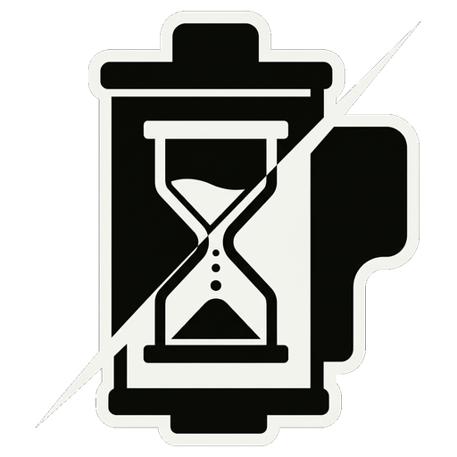
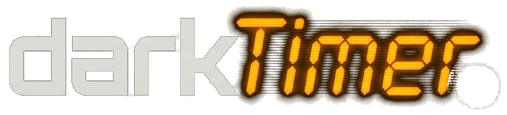

<p align="center">
  &nbsp;&nbsp;
  
</p>

<p align="center">
  <a href="https://darktimer.app/"></a>
  
  
  
</p>

---

A touch-friendly, VCR/VFD-inspired black-and-white film development timer built
with SolidJS and Vite. It runs at [darktimer.app](https://darktimer.app/) and can
also be run locally with Node or Docker.

## What it does

1. Configures an optional presoak.
2. Loads a small local catalog of manufacturer-published and clearly labeled
   community-reported development times.
3. Supports a Custom recipe with manually entered film, developer, required
   dilution, time, temperature, EI, and format.
4. Calculates developer and water volumes for supported dilution formats.
5. Builds a process chain with fixed documented presets and explicit Custom
   controls for stop bath, fixing, washing, and Photo-Flo times.
6. Runs a chained timer with pour prompts, agitation cues, and audio controls,
   then offers to turn a completed Custom recipe into a draft submission.

Each selected recipe shows its source, confidence classification, and agitation
method. The catalog deliberately excludes the former bulk developer datasets and
does not call the 35mm.org API while their redistribution or API terms remain
unclear. See [DATA_SOURCES.md](DATA_SOURCES.md) for provenance.

The in-app submission form turns an original darkroom test or a manufacturer
publication into a draft public GitHub issue. Community reports remain labeled
`community-reported`, use the issue submission date, require contributor
permission, and are never presented as manufacturer data.

## Safety

The manufacturer label and safety data sheet control. Check all times,
temperatures, dilutions, and agitation methods before processing important film.
Use appropriate protective equipment and ventilation, and follow local disposal
rules. Read [SAFETY.md](SAFETY.md) before relying on the timer.

## Local development

```sh
npm install
npm run dev
```

## Test and build

```sh
npm test
npm run build
```

## Docker

```sh
docker compose up --build
```

Open <http://localhost:8080>.

## Licensing

- Project-owned code, documentation, and recipe-data compilation: Apache-2.0,
  in [LICENSE](LICENSE)
- DSEG7 font: SIL Open Font License 1.1, in
  [public/assets/fonts/DSEG-LICENSE.txt](public/assets/fonts/DSEG-LICENSE.txt)
- Other third-party material and names: [THIRD_PARTY_NOTICES.md](THIRD_PARTY_NOTICES.md)

Contributions must meet the provenance and licensing requirements in
[CONTRIBUTING.md](CONTRIBUTING.md).

## Privacy

Recipe selections stay in the browser. The application code does not set
cookies, run analytics, or send selections to a darkTimer data server. Static
hosting and external links can still create normal web requests. See
[PRIVACY.md](PRIVACY.md).
